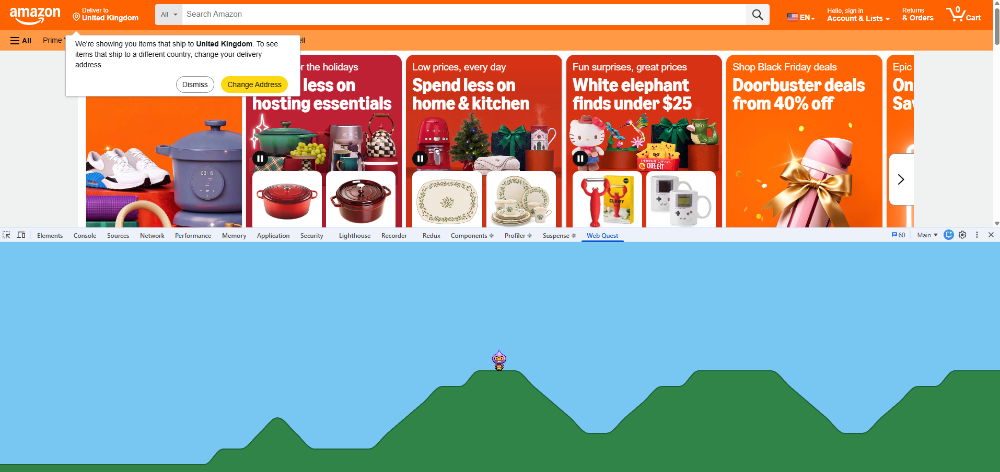

# Web Quest

A 2D arcade-style open world game concept.
Web Quest is a Chrome DevTools extension, which allows your avatar to explore environments that are dynamically generated from the HTML markup that composes websites that you are visiting in your browser.

Web Quest turns the structure of a web page into a landscape you can walk across. For example, a page might contain a section with a list inside it. As the game moves through those nested elements, the ground rises, then slopes back down as it leaves them. The game connects those changes into smooth hills and valleys, so pages with different structures can produce different terrain.



## Running the game

### Served via dev server

Install Node on your computer and clone this repository, then run:

```
npm ci
```

To run Web Quest locally in your web browser, run:

```
npm start
```

Open http://localhost:3000 in your browser.
When running Web Quest directly in the browser it uses a data fixture in order to generate the game environment.

Run `npm run lint` to check the JavaScript with ESLint. On Node.js 22, ESLint requires version 22.13.0 or later.

### As a local Chrome extension

To test or debug Web Quest as a Chrome DevTools extension, build the extension first:

```
npm run deploy
```

This generates everything Chrome needs to unpack the extension inside of the dist folder.

- In Chrome go to chrome://extensions and toggle Developer Mode to be on.
- Click Load Unpacked and select the dist folder

Open a regular web page, open Chrome DevTools, and select the **Web Quest** panel. The level is generated from the inspected page and refreshes when that tab finishes loading a new page.
